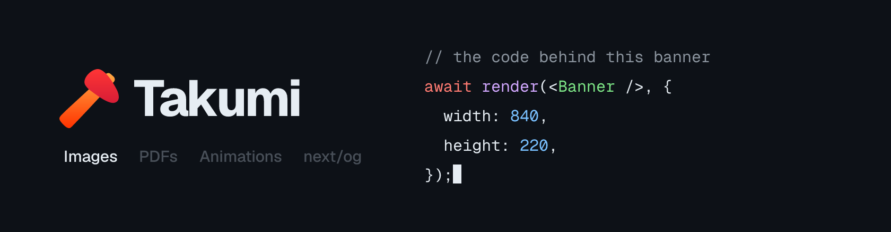
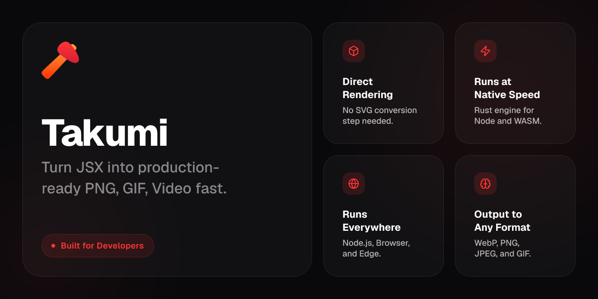
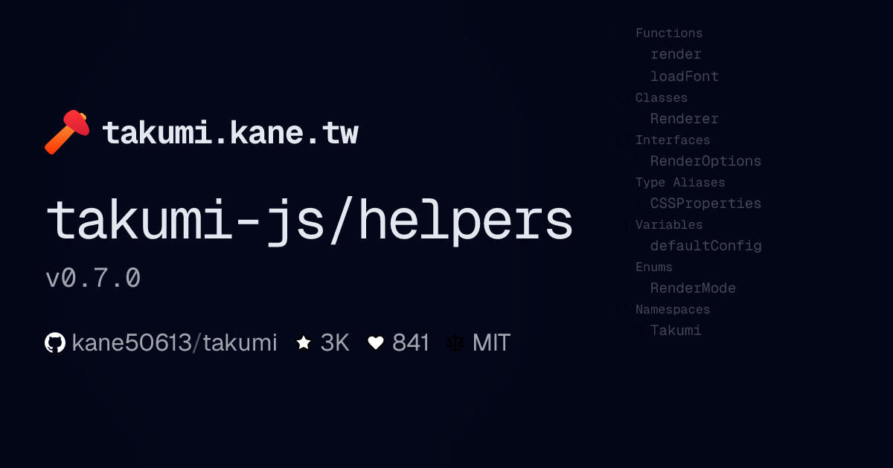
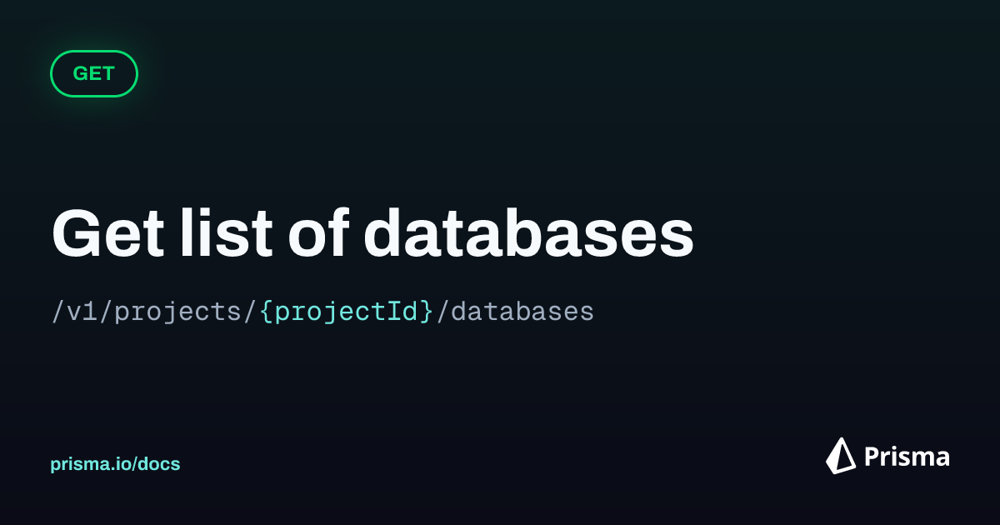
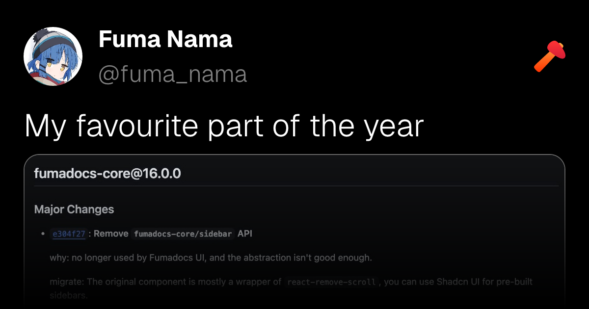
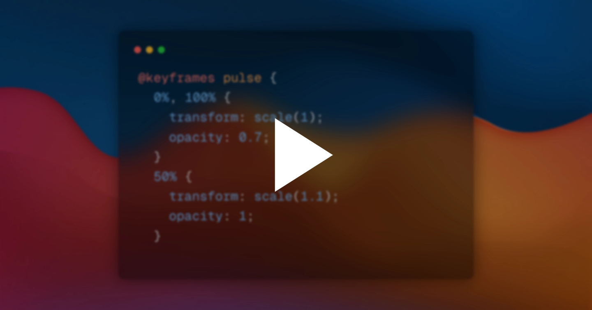

<div align="center">
  <a href="./example/twitter-images/components/readme-banner.tsx">
    
  </a>

**Render JSX, HTML, and CSS to images, SVG, PDFs, or a paint tree without a headless browser.**

[](https://www.npmjs.com/package/takumi-js)
[](https://www.npmjs.com/package/takumi-pdf)
[](https://www.npmjs.com/package/takumi-paint)
[](https://crates.io/crates/takumi)
[](https://www.npmjs.com/package/@takumi-rs/core)
[](#license)

[Documentation](https://takumi.kane.tw/docs/) · [Playground](https://takumi.kane.tw/playground) · [Showcase](https://takumi.kane.tw/showcase)

</div>

Takumi is a Rust layout engine whose block, inline, flexbox, grid, and table layout ports Chromium's Blink, paired with HarfRust for text shaping and Skrifa for font reading. One laid-out tree feeds four backends, so the same JSX or HTML component can render as a raster image, an SVG, a PDF, or a paint tree of resolved boxes and text runs. It runs without a headless browser on Node.js, Bun, Cloudflare Workers, browsers, and Rust.

## Packages

| Package                                                                      | Output                                                        | Runtime                                            |
| :--------------------------------------------------------------------------- | :------------------------------------------------------------ | :------------------------------------------------- |
| [`takumi-js`](./takumi-js) ([docs](https://takumi.kane.tw/docs/))            | PNG, JPEG, WebP, ICO, raw RGBA, SVG, animated WebP, APNG, GIF | Node.js, Bun (native), Workers and browsers (Wasm) |
| [`takumi-pdf`](./takumi-pdf-js) ([docs](https://takumi.kane.tw/docs/pdf))    | Paged or single-page PDF with selectable text                 | Node.js, Bun, Workers, and browsers (Wasm)         |
| [`takumi-paint`](./takumi-paint) ([docs](https://takumi.kane.tw/docs/paint)) | Paint tree of boxes, text runs, and images with resolved CSS  | Node.js, Bun, Workers, and browsers (Wasm)         |
| [`takumi`](./takumi) ([docs](https://docs.rs/takumi))                        | Images, animations, and SVG from a node tree or HTML          | Rust                                               |
| [`takumi-cli`](./takumi-cli) ([docs](https://takumi.kane.tw/docs/cli))       | Images, SVG, and PDF from HTML files in allowed directories   | Terminal                                           |

Low-level bindings and helpers live in [`@takumi-rs/core`](./takumi-napi), [`@takumi-rs/wasm`](./takumi-wasm), and [`@takumi-rs/helpers`](./takumi-helpers). See the [node reference](https://takumi.kane.tw/docs/reference#node-types) for the underlying node-tree format.

## Quick Start

Install the package for your output. The examples below use Bun to run JSX directly.

```bash
bun i takumi-js      # PNG, JPEG, WebP, SVG, animations
bun i takumi-pdf     # paged PDF
bun i takumi-paint   # paint tree
```

### Image

Save this as `image.tsx` and run `bun image.tsx` to write a 1200 × 630 PNG.

```tsx
import { render } from "takumi-js";
import { writeFile } from "node:fs/promises";

const image = await render(
  <div tw="w-full h-full flex items-center justify-center bg-linear-to-b from-blue-100 to-red-50">
    <h1 tw="text-6xl font-bold">Hello from Takumi</h1>
  </div>,
  { width: 1200, height: 630 },
);

await writeFile("./output.png", image);
```

### PDF

Save this as `document.tsx` and run `bun document.tsx` to write an A4 PDF with a page-number footer.

```tsx
import { render } from "takumi-pdf";
import { PageNumber, TotalPages } from "takumi-pdf/primitives";
import { writeFile } from "node:fs/promises";

const pdf = await render(
  <main>
    <h1>Invoice</h1>
    <p>Total: $1,250.00</p>
  </main>,
  {
    size: "a4",
    footer: (
      <div tw="flex w-full justify-center text-[10px] text-gray-500">
        Page <PageNumber /> of <TotalPages />
      </div>
    ),
  },
);

await writeFile("invoice.pdf", pdf);
```

### Paint

Save this as `paint.tsx` and run `bun paint.tsx` to print each text run with its font.

```tsx
import { paint } from "takumi-paint";

const tree = await paint(
  <div style={{ width: 240, padding: 16, background: "#F7F3EC" }}>
    Hello <b>world</b>
  </div>,
  { width: 320 },
);

for (const node of tree.nodes) {
  if (node.type !== "text") {
    continue;
  }

  for (const run of node.runs) {
    console.log(run.text, run.font.family, run.fontSize);
  }
}
```

`tree.steps` lists the draws in paint order. See [Drawing](https://takumi.kane.tw/docs/paint/drawing) to replay them on a canvas.

### More Examples

<details>
<summary>Google Fonts</summary>

```tsx
import { render } from "takumi-js";
import { googleFonts } from "takumi-js/helpers";

const image = await render(
  <div
    tw="w-full h-full flex items-center justify-center"
    style={{
      fontSize: 72,
      fontFamily: "Fraunces",
      fontVariationSettings: "'opsz' 72, 'wght' 700",
    }}
  >
    Hello from Takumi
  </div>,
  {
    width: 1200,
    height: 630,
    fonts: googleFonts([{ name: "Fraunces", weight: "100..900", axes: { opsz: "9..144" } }]),
  },
);
```

`render()` registers only the font subsets the content uses, and every render in the process shares the fonts it loaded. See [Fonts](https://takumi.kane.tw/docs/fonts#reusing-fonts-across-renders).

</details>

<details>
<summary>API route (<code>next/og</code>-compatible)</summary>

```tsx
import { ImageResponse } from "takumi-js/response";

export function GET() {
  return new ImageResponse(
    <div tw="w-full h-full flex items-center justify-center bg-linear-to-b from-blue-100 to-red-50">
      <h1 tw="text-6xl font-bold">Hello from Takumi</h1>
    </div>,
    { width: 1200, height: 630 },
  );
}
```

</details>

<details>
<summary>Animated WebP</summary>

```tsx
import { renderAnimation } from "takumi-js";
import { writeFile } from "node:fs/promises";

const animation = await renderAnimation({
  width: 400,
  height: 400,
  fps: 30,
  format: "webp",
  scenes: [
    {
      durationMs: 1000,
      node: (
        <div tw="w-full h-full flex items-center justify-center">
          <div tw="w-32 h-32 bg-blue-500 animate-spin rounded-lg" />
        </div>
      ),
    },
  ],
});

await writeFile("./output.webp", animation);
```

</details>

<details>
<summary>Vector SVG</summary>

```tsx
import { renderSvg } from "takumi-js";
import { writeFile } from "node:fs/promises";

const svg = await renderSvg(
  <div tw="w-full h-full flex items-center justify-center bg-linear-to-b from-blue-100 to-red-50">
    <h1 tw="text-6xl font-bold">Hello from Takumi</h1>
  </div>,
  { width: 1200, height: 630 },
);

await writeFile("./output.svg", svg);
```

</details>

<details>
<summary>Rust</summary>

```bash
cargo add takumi
```

Start from the [Rust example](./example/rust) or the [crate docs](https://docs.rs/takumi).

</details>

## Highlights

- **Layout and CSS** covers flexbox, CSS Grid, block, inline, table, and float layout, plus Tailwind v4 utilities, complex selectors, `var()`, `calc()`, media queries, and `corner-shape`.
- **Typography and scripts** handles Arabic shaping, bidirectional text, `lang`-aware CJK glyphs, emoji (with matching fonts), `text-fit`, `text-wrap: balance` and `pretty`, and `offset-path` text.
- **Images and animations** renders masks, clipping, blend modes, SVG filters (`feTurbulence`, `feDisplacementMap`), conic gradients, and `@keyframes` animations to WebP, APNG, GIF, or video frames.
- **PDF documents** handles page breaks, widows and orphans (default 2), repeating headers, footers, and table `<thead>`/`<tfoot>`, selectable subsetted text, bookmarks (`outline: true`), Factur-X attachments, and tagged PDF by default ([PDF/A and PDF/UA](https://takumi.kane.tw/docs/pdf/conformance)).
- **Runtimes** ships prebuilt native bindings for Node.js and Bun (macOS, Linux glibc/musl, Windows on x64 and ARM64), WebAssembly for Cloudflare Workers and browsers (`takumi-pdf` and `takumi-paint` use Wasm everywhere), and the `takumi` Rust crate.

## Migrating & Tradeoffs

Takumi implements a subset of browser CSS and does not run page scripts. In PDF output, `filter` supports only color functions, so `blur()`, `drop-shadow()`, and `backdrop-filter` are not drawn. Keep Puppeteer or Playwright when your output depends on JavaScript execution or full browser layout, and compare your templates before switching.

| You are using           | What changes                                                                                                                                                                                                   |
| :---------------------- | :------------------------------------------------------------------------------------------------------------------------------------------------------------------------------------------------------------- |
| `satori`                | Replace `satori()` with `renderSvg()`, or call `render()` for encoded image bytes. [Compare the renderers](https://takumi.kane.tw/docs/migration/satori).                                                      |
| `next/og`               | Swap the `ImageResponse` import, keep explicit Flexbox styles, and compare the output. [Read the migration guide](https://takumi.kane.tw/docs/migration/satori#migrate-from-nextog).                           |
| Puppeteer or Playwright | Replace `page.pdf()` with `render()`. You must preload remote assets, and Takumi supports less CSS than Chrome. [Read the migration guide](https://takumi.kane.tw/docs/pdf/migration/puppeteer).               |
| `@react-pdf/renderer`   | Replace `Document`, `View`, and `Text` with HTML elements and CSS. Browser viewers and some text controls have no equivalent. [Read the migration guide](https://takumi.kane.tw/docs/pdf/migration/react-pdf). |
| `pdfkit`                | Use JSX or HTML instead of positioning each line. Keep `pdfkit` when you need low-level drawing control.                                                                                                       |

For invoice benchmarks against `@react-pdf/renderer` and Puppeteer, see the [PDF renderer comparison](https://takumi.kane.tw/docs/pdf/comparison).

## Showcase

|                                 Takumi OG image [(source)](./example/twitter-images/components/og-image.tsx)                                 |                Package OG card [(source)](./example/twitter-images/components/package-og-image.tsx)                 |
| :------------------------------------------------------------------------------------------------------------------------------------------: | :-----------------------------------------------------------------------------------------------------------------: |
|                                                                              |                                            |
|                        **Prisma-style API card** [(source)](./example/twitter-images/components/prisma-og-image.tsx)                         |              **X-style social post** [(source)](./example/twitter-images/components/x-post-image.tsx)               |
|                                                                       |                                              |
|                             **Keyframe Animation** [(source)](./example/ffmpeg-keyframe-animation/src/index.tsx)                             |                                **[shiki-image](https://github.com/pi0/shiki-image)**                                |
| [](./example/ffmpeg-keyframe-animation/output/animation.mp4) |  |

More examples live in [`example/`](./example) for [invoices](./example/generate-invoice), [e-invoices](./example/e-invoice), [Next.js](./example/nextjs), [Cloudflare Workers](./example/cloudflare-workers), [TanStack Start](./example/tanstack-start), [Svelte](./example/svelte), [Rust](./example/rust), and [ffmpeg keyframe animation](./example/ffmpeg-keyframe-animation), alongside the [(Unofficial) Takumi Playground](https://takumi-playground.kapadiya.net/).

## Used By

- [Dcard](https://dcard.tw) renders post share images
- [TanStack](https://tanstack.com) renders OG images for its docs
- [Fumadocs](https://fumadocs.dev) generates its docs OG images
- [Nuxt OG Image](https://nuxtseo.com/docs/og-image/renderers/takumi) ships Takumi as a built-in renderer
- [Luma](https://lu.ma) renders event share images
- [shiki-image](https://github.com/pi0/shiki-image) turns syntax-highlighted code into images

See more in the [showcase](https://takumi.kane.tw/showcase). Takumi is part of the [Vercel OSS Program](https://vercel.com/oss).

## Contributing

Read [CONTRIBUTING.md](./CONTRIBUTING.md) for local setup and the fixture workflow. Bug reports, feature requests, doc improvements, and new example integrations are welcome.

## License

MIT or Apache-2.0. Bundled third-party code is listed in [THIRD-PARTY-NOTICES.md](THIRD-PARTY-NOTICES.md).

<br/>
<a href="https://vercel.com/oss">
  
</a>
