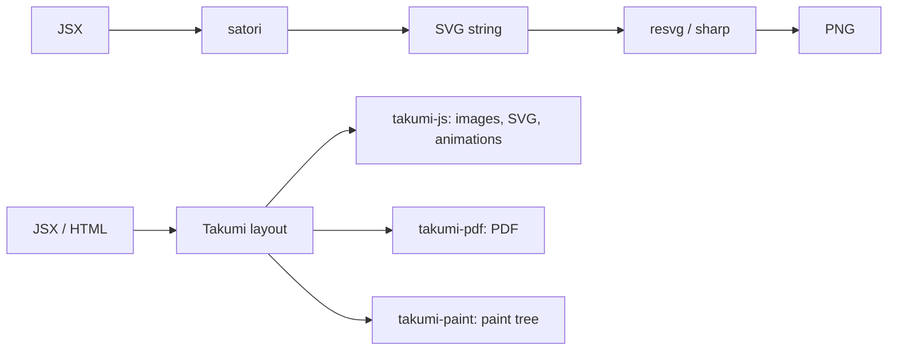

[satori](https://github.com/vercel/satori) turns JSX into an SVG string. `next/og` pairs an older satori with [resvg](https://github.com/yisibl/resvg-js) to return a PNG. Takumi renders the same JSX to images, SVG, and more.

To switch, follow [Migrate from satori](#migrate-from-satori) or [Migrate from `next/og`](#migrate-from-nextog). To compare first, read [How Takumi differs](#how-takumi-differs) and [Features](#features).

## Migrate from satori

`renderSvg` replaces `satori()`. It takes JSX and returns an SVG string. The built-in Latin font makes `fonts` optional.

```tsx title="Replace satori with renderSvg"
import satori from "satori"; // [!code --]
import { renderSvg } from "takumi-js"; // [!code ++]

const svg = await satori(<div style={{ display: "flex" }}>Hello</div>, { // [!code --]
const svg = await renderSvg(<div style={{ display: "flex" }}>Hello</div>, { // [!code ++]
  width: 1200,
  height: 630,
  fonts: [{ name: "Inter", data: interBytes, weight: 400, style: "normal" }], // [!code --]
});
```

For a bitmap, skip the SVG step. `render` returns encoded bytes in one call.

```tsx twoslash title="Render PNG directly"
import { render } from "takumi-js";

const png = await render(<div tw="w-full h-full flex items-center justify-center">Hello</div>, {
  width: 1200,
  height: 630,
});
```

## Migrate from `next/og`

[`ImageResponse`](/docs/reference/image-response) follows the `next/og` API, including the `emoji` option. Swap the import.

```tsx title="Replace the next/og import"
import { ImageResponse } from "next/og"; // [!code --]
import { ImageResponse } from "takumi-js/response"; // [!code ++]

export function GET() {
  return new ImageResponse(<div tw="w-full h-full flex items-center justify-center">Hello</div>, {
    width: 1200,
    height: 630,
  });
}
```

<Callout type="warn">
  `next/og` makes every element a flex container. In Takumi, a `<div>` is `display: block`, as in a browser. Add `display: flex` or `tw="flex"` to each container that needs Flexbox. Compare the output before you deploy.
</Callout>

The [Next.js guide](/docs/frameworks/nextjs) covers the route handler setup.

## Fonts

satori throws without a `fonts` entry. Takumi ships Geist (Latin, weights 300 to 800) as a last-resort font, so Latin text renders with no setup.

For other scripts, [`googleFonts`](/docs/reference/helpers#fonts) loads families in one call. `fonts` also takes raw bytes, descriptors, or URL strings.

```tsx twoslash title="Load a CJK font"
import { render } from "takumi-js";
import { googleFonts } from "takumi-js/helpers";

const png = await render(
  <div style={{ fontFamily: "Noto Sans TC" }} tw="w-full h-full flex text-7xl">
    你好，匠
  </div>,
  {
    width: 1200,
    height: 630,
    fonts: googleFonts([{ name: "Noto Sans TC", weight: 700 }]),
  },
);
```

satori 0.63 draws a variable font at its default instance. Takumi applies `font-weight` and `font-variation-settings` along the font's axes. See [Fonts](/docs/fonts).

## Emoji

`next/og` resolves emoji through satori's `loadAdditionalAsset` callback. Takumi's `ImageResponse` and `render` take the same `emoji` option with the same values, and [Image loading & emoji](/docs/images#dynamic-fetching) lists each set and where it comes from.

To draw emoji from a registered color font, set `emoji: "from-font"`. See [Emoji](/docs/images#emoji).

## How Takumi differs

Takumi is one Rust engine. Its text and inline layout port Chromium's Blink, and the same layout feeds three packages.

| Package        | Output                                                                   |
| :------------- | :----------------------------------------------------------------------- |
| `takumi-js`    | PNG, JPEG, WebP, ICO, raw pixels, SVG, and animated WebP, APNG, or GIF   |
| `takumi-pdf`   | Paged [PDF](/docs/pdf) with selectable text                              |
| `takumi-paint` | A [paint tree](/docs/paint) to draw with Canvas, slides, or a native API |



Compare rendered output across renderers at [image-bench.kane.tw](https://image-bench.kane.tw).

## Features

satori changes quickly, so this table names versions. `next/og` in Next.js 16.4 bundles `@vercel/og` 1.0.1, which uses satori 0.29. The satori column follows the satori 0.63 README.

| Feature                           | `next/og`           | satori 0.63                                     | Takumi                                                            |
| :-------------------------------- | :------------------ | :---------------------------------------------- | :---------------------------------------------------------------- |
| Layout                            | Flexbox only (Yoga) | Flexbox, Grid, block (Taffy), own inline layout | Flexbox, Grid, block, float, tables, and inline layout from Blink |
| `display` of a bare `<div>`       | `flex`              | `block`                                         | `block`                                                           |
| Tables                            | ❌                  | ❌ throws                                       | ✅ [Tables](/docs/tables)                                         |
| `<style>`, selectors, `@media`    | ❌                  | ✅                                              | ✅                                                                |
| `calc()`, `z-index`               | ❌                  | ✅                                              | ✅                                                                |
| `@keyframes` and animated output  | ❌                  | ❌ `@keyframes` is ignored                      | ✅ [Keyframe animation](/docs/animation)                          |
| React hooks (`useState`, `use()`) | ❌                  | ❌                                              | ✅ initial state, no effects                                      |
| WOFF2                             | ❌                  | ✅                                              | ✅                                                                |
| Right-to-left text                | ❌                  | Partial                                         | ✅                                                                |
| Built-in font                     | Geist Regular       | None, `fonts` is required                       | Geist, Latin, weights 300 to 800                                  |
| Output                            | PNG                 | SVG                                             | Raster, SVG, animation, PDF, paint tree                           |

Takumi also takes HTML strings and node trees as input. See [Parsing templates](/docs/reference/helpers#parsing-templates).

## Rendering on a server

satori builds the SVG on the calling thread. On Node.js, Takumi's native binding runs each render as a background task, which has these effects:

- Renders leave the event loop free, and concurrent renders share the loaded fonts.
- Animation frames render in parallel and stream into the encoder, so it does not hold every raw frame.
- Images decode at their drawn size where the format allows it, and the decode cache reuses them across renders.
- Fonts load by coverage. `googleFonts` returns each family as `unicode-range` subsets, and a render downloads only the subsets its text uses.

Edge runtimes and browsers load Takumi as a WebAssembly binary. Count its download and compile time when you measure cold starts. See [Performance](/docs/performance) for tuning.

## Used in production

[Dcard](https://dcard.tw), [TanStack](https://tanstack.com), [Fumadocs](https://fumadocs.dev), and [Luma](https://lu.ma) render share images with Takumi. [Nuxt OG Image](https://nuxtseo.com/docs/og-image/renderers/takumi) ships it as a renderer. See more in the [showcase](https://takumi.kane.tw/showcase).
