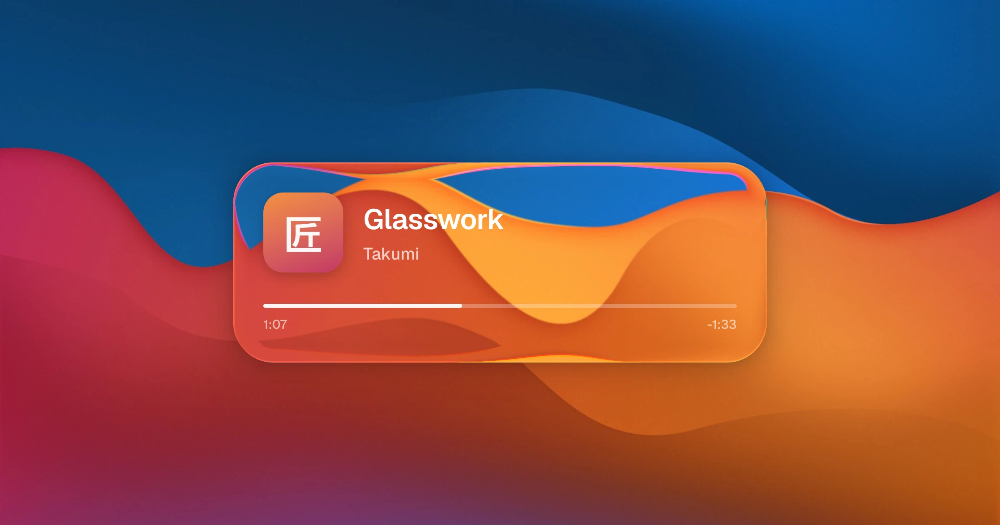

# Apply a liquid glass shader to a Takumi image

Render a scene as raw RGBA pixels, run a liquid glass shader over them with WebGPU, and compose the result into a final image with Takumi.



## Run

Build the [image example packages](../README.md#image-examples) first. Then run the script with Node.js:

```bash
cd example/liquid-glass
node src/index.ts        # WebGPU shader
node src/index.ts --cpu  # the same math in TypeScript, no GPU
```

The GPU run writes `output/liquid-glass.webp`. The CPU run writes `output/liquid-glass-cpu.webp`. Both print how long the filter took.

Use a Node.js version that runs TypeScript files directly, such as 22.18 or newer. The [`webgpu`](https://www.npmjs.com/package/webgpu) package provides Dawn, the WebGPU implementation, for Node.js. The script loads fonts from Google Fonts, so it needs network access.

## How it works

1. `render()` with `format: "raw"` draws the wallpaper at 2× and returns its pixels.
2. [`src/liquid-glass.ts`](./src/liquid-glass.ts) runs the WGSL shader over those pixels. [`src/liquid-glass-cpu.ts`](./src/liquid-glass-cpu.ts) is the TypeScript version.
3. A second `render()` places the filtered pixels as an image node and draws the widget on top.

The shader ports the pipeline from [whynotmake-it/flutter_liquid_glass](https://github.com/whynotmake-it/flutter_liquid_glass) to WGSL. It uses a circular-arc height profile over a squircle, Snell refraction through the surface normal, chromatic aberration, and rim lighting tinted by the background.
